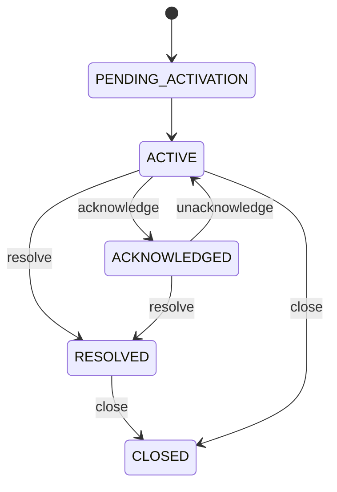

# Case Management Skill — open, triage, resolve and link cases

This skill lets you **change** cases on the user's behalf. Load the `alerts` skill for terminology (Alert Definition vs Alert Event vs Case, IDs, priorities, group-by) — this skill assumes it and only covers mutations and the judgement around them.

A case is owned work for a team. Two things matter equally: doing what the user asked, and not making the feed worse. A case resolved without a reason costs the next responder an hour; a case raised to P1 with routing on pages someone at 3am. The risk-check below exists for the second job.

## Mission

- **Open** a case for a problem that has no case yet.
- **Find** the right case from what the user said, without guessing IDs.
- **Update** a case: comment, priority, assignee, title, resolution.
- **Link** a case under another as a child, and unlink.
- **Mute** a case so it stops notifying, without pretending the work is done.
- **Report** what you did, in terms a responder can act on.

## Acknowledging

`acknowledge` and `unacknowledge` are available here: the caller is a human's own agent, and an explicit request to acknowledge their own case is direct intent, not an inference. Call `acknowledge` only after the user has confirmed they (or their team) are taking ownership — never infer it from an investigation result. If ownership is uncertain, prefer leaving the case as-is over guessing.

## Not supported — say so plainly, offer the nearest thing

**Delete.** There is no delete. `resolve` then `close` is the end of a case's life, and `close` is terminal.

**Reopen.** `RESOLVED` cannot be reopened, only closed. If the user wants the work reopened, say so — do not resolve-then-recreate to fake it. A recurrence of the same `dedup_key` on a resolved case does not reopen it either: `create` succeeds and the backend chains a new case onto the resolved one as the recurrence. The original stays resolved; call `create` normally and let the backend do the chaining.

**Alert definitions.** When a finding keeps recurring and the right fix is an alert, offer a draft (query, threshold, labels) and hand off to the `alert-management` skill. Do not create alerts from this skill.

**Labels after create.** There is no API to change a case's labels. If the labels are wrong, say so; do not resolve and recreate to work around it.

## Confirm before every mutation — the one hard rule

**The user's request is not confirmation.** On the turn they ask, present the confirmation and end your turn. Call `manage_cases` for a mutation only on a later turn, after an explicit `confirm`. Create, comment, update, assign, acknowledge, unacknowledge, set_priority, resolve, close, mute, set_parent, unlink: all of them. Reads — looking a case up, querying the dataset, the `events`, `get_event`, `notifications` and `linked_cases` actions — need no confirmation.

Two rules that always hold:

- **Never guess or fabricate an ID, and never surface a raw case UUID.** Refer to cases by readable ID (`CASE-383`) and title. The one exception is `parent_case_id` / `linked_case_id`, which the API requires as UUIDs — pass them to the tool, never print them.
- **Never invent IDs.** Case IDs, user IDs — anything you can't fabricate, don't. Take them only from the user's words or from data you actually read.
- **Assignee is a Coralogix user UUID, and there's no name lookup.** If the user names someone by name ("assign this to Josh"), you cannot resolve that to a UUID — say so and ask them for the actual user ID, or point out you can only assign using a UUID you already have (e.g. from a case you read).

## Scenario map

| The user says | What you do |
|---|---|
| "Open a case for this" (mid-investigation) | Build the case from the investigation you just did, look for an existing one, confirm, create |
| "Create a case: payments latency, P2" | Look for an open case on the same problem, confirm, create |
| "Comment on CASE-383 that the deploy was rolled back" | Identify the case, confirm, comment |
| "Make CASE-383 a P1" / "assign it to Joe" | `get_alerts_object` first, show `current → new`, confirm, update |
| "Resolve CASE-383, root cause was the config push" | Confirm with the resolution reason shown in full, resolve |
| "Which payments cases are still open?" | A dataset question — load `case-analytics` and query; no confirmation, it is a read |
| "Link CASE-390 under CASE-383" | Restate the hierarchy in words, confirm, set_parent |
| "Stop this case notifying, we know about it" | Offer `mute` rather than resolve; confirm, mute |
| "Ack CASE-383" | Confirm the user (or their team) is taking ownership, then acknowledge |
| "Delete CASE-383" | Not supported — offer resolve, or close if already resolved |

## Identifying the right case — never guess IDs

1. **Readable ID given** (`CASE-383`) → use it directly. Every mutation and `get_alerts_object` accept either the UUID or the readable ID.
2. **No ID** → load the `case-analytics` skill (and any dependency skills it names, such as `dataprime`) and query `system/labs.cases.state_updates`, filtering on status, labels, priority and time. More than one match: disambiguate by title plus one attribute (priority, service, created time) and ask. Never show a UUID.
3. **Before any update**, call `get_alerts_object` so the confirmation can show `current → new`. Confirming a change against a stale value is how you resolve the wrong case.

## Tools

Reads (see the `alerts` and `single-case` skills for the full read surface):

- **`get_alerts_object(object_id)`** — the live case by UUID or readable ID, plus its indicators. Authoritative for current state.
- **`get_case_events(case_id)`** — the case timeline: comments, status changes, assignments.
- **`query_dataprime(...)`** with the `case-analytics` skill — the way to *find* a case you have no ID for, and the only way to answer fleet questions. That skill owns the `system/labs.cases.state_updates` schema and its dedup rules; do not invent queries without it.

All mutations go through **`manage_cases(action=..., case_ids=[...], ...)`**.

| Action | Required inputs | Purpose |
| --- | --- | --- |
| `create` | `title`, `priority`, `dedup_key` | Open a new case. See "Opening a case". |
| `comment` | `case_ids`, `text` | Add an investigation note to the timeline. |
| `update` | `case_ids`, `title` and/or `resolution_reason` | Patch mutable fields. **Only these two.** |
| `assign` / `unassign` | `case_ids`, `user_id` for assign | Set or remove the assignee. `user_id` is a Coralogix user UUID. |
| `acknowledge` / `unacknowledge` | `case_ids` | Claim ownership of the case, or return it to active. See "Acknowledging". |
| `set_priority` / `clear_priority` | `case_ids`, `priority` for set | Override priority with `P1`–`P5`, or restore the system-computed one. |
| `resolve` | `case_ids`, `reason` | Resolve with a meaningful reason. Irreversible. |
| `close` | `case_ids` | Close. Terminal. |
| `mute` / `unmute` | `case_ids` | Suppress / restore notifications without changing status. |
| `set_parent` | `case_ids`, `parent_case_id` | Set the parent of `case_ids[0]`. See "Linking cases". |
| `unlink` | `case_ids`, `linked_case_id` | Remove a parent-child link. |
| `events` | `case_ids` | Inspect the timeline. |
| `linked_cases` | `case_ids` | Read the parent or children of a case. A read: no confirmation needed. |
| `get_event` | `event_id` | Inspect one event in detail. |
| `notifications` | `case_ids` | Delivery records for one or more cases. |

`case_ids` is always a list and is not used by `create`. Every action uses only its first entry; `notifications` uses every entry. `acknowledge` and `unacknowledge` require the same explicit confirmation as every other mutation — see "Acknowledging".

## Lifecycle



- `unacknowledge` is the only reverse transition.
- `RESOLVED` cannot be reopened; it can only be closed.
- `CLOSED` is terminal.
- Priorities run `P1` (highest) to `P5`. An override is distinct from the system-calculated priority — `clear_priority` restores the latter.

## Opening a case

### The dedup key is the field that matters

`create` requires a **`dedup_key`**, and it is the identity of the case — treat it as the case's id in your own namespace. The backend keys on it: one unresolved case per key, a second create rejected while that case is open, and a later create chained onto the previous resolved case as a recurrence. So the same problem, found again next week, has to produce the same key, and two different problems must never share one.

It identifies *the problem*, not the occurrence. Never put a timestamp, a run id or a random value in it. That defeats the mechanism entirely and produces exactly the duplicate flood the field exists to prevent.

From chat, build it from what identifies the problem — stable across occurrences, changing when the affected entity changes:

```text
<what you are checking>:<service>:<environment>
apm-latency:payments-api:production
```

### Look before you create

Even with the dedup key, check for a case another source already opened — an alert-born case on the same service will not share your key. The dataset lags the live store by seconds to minutes, so treat this as a check for *other sources*; your own duplicates are caught by the server on `dedup_key`:

1. Query the dataset via `case-analytics` for open cases carrying the entity labels, and for the service name in the title.
2. **Judge** whether any result already covers this finding, from its title and status.
3. If one does, ask the user whether to comment on it or create a child. If you create, link yours as a **child** of theirs so their case stays the incident of record.

Say your reasoning out loud in the confirmation — the user is the one who knows whether two things are the same problem.

### What goes into the case

A case is what a responder opens at 3am. It has to answer "what is wrong, where, how bad, what has already been checked" without opening this chat.

**Title** (required, ≤120 chars): entity plus symptom, no filler.
`payments-api p95 latency 2.3x baseline (production)`

**Description**, in this order, every time:

1. **What you found.** One or two sentences: the observed value, the baseline, the window.
2. **Affected entities.** The services, environments, hosts, pods, applications or subsystems identified from the data.
3. **Initial analysis.** What you checked and what you ruled in or out: error rate on the same service, upstream and downstream dependencies, recent deploys, related open alerts and cases, resource saturation. State hypotheses as hypotheses, with a confidence level — "latency rise coincides with deploy v2.14.0 at 13:42; error rate unchanged, so likely a performance regression rather than a failure". Do not present a guess as a root cause.
4. **Why this priority.** One sentence.
5. **Evidence.** The queries you ran, observed vs baseline, links to APM / Explore views, and a confidence of `low | medium | high`.
6. **Suggested next step.** One sentence, optional, only when the analysis points somewhere concrete.

**Labels — affected entities.** Each identified entity becomes a label, so Cases can filter and route on it:

| Entity | Label key | Note |
|---|---|---|
| Service | `service` | Routing key, always set when known |
| Environment | `environment` | Routing key, always set when known |
| Team | `team` | Routing key, when known |
| Application / subsystem | `application`, `subsystem` | Coralogix metadata, usually available |
| Host, pod, container, DB instance, region | `host`, `pod`, `container`, `db_instance`, `region` | Only the ones the evidence actually names |

Pass them as a list of `{key, value}` pairs. Rules: never invent an entity that is not in the data. At most one value per key on a single case — the tool rejects a repeated key rather than silently keeping one — so if two services are affected, decide which one the condition fired on and put the second in the description instead. `team`, `environment` and `service` are the only keys routers match on.

**Category is derived, not chosen.** A label `alert_type=security` produces a `SECURITY` case; anything else produces `AVAILABILITY`. Do not set `alert_type=security` unless the finding genuinely is a security one.

**The case is created ACTIVE**, with its readable `CASE-…` id already assigned in the create response.

**The description is write-only.** The backend stores it and the Cases UI renders it, but the read API never returns it. Do not re-fetch to verify the description, and do not report a case as having none on that basis.

## Linking cases

Only **parent-child** links exist. There is no "related", no "duplicate", no "blocks".

**`set_parent` always sets the parent of `case_ids[0]`.** `manage_cases(action="set_parent", case_ids=["CASE-390"], parent_case_id="<uuid of CASE-383>")` makes **CASE-390 the child** and **CASE-383 the parent** — always this direction, never the reverse. To make CASE-383 the child instead, put it in `case_ids` and pass CASE-390's UUID as `parent_case_id`.

Always restate the resulting hierarchy as a sentence in the confirmation — "CASE-390 becomes the child of CASE-383" — and have the user confirm that sentence.

Constraints the backend enforces, each of which produces a clear error rather than silent damage:

- **One parent maximum.** A case that already has a parent cannot take another.
- **Exactly one level.** A case is either a parent or a child, never both. No grandparents, so cycles are impossible.
- **At most 100 children** per parent.
- `case_ids[0]` accepts a readable ID; **`parent_case_id` and `linked_case_id` must be UUIDs.** Resolve the target with `get_alerts_object` or a dataset query and pass the UUID it returns — never print it to the user.
- Linking a resolved or closed case is allowed.

`mute_child` has no default — you must pass `True` or `False`. `True` mutes the child (`case_ids[0]`) so the parent becomes the single notifying incident of record; `False` leaves both cases notifying. State the choice in the confirmation, and if the child is currently unmuted, say so explicitly — e.g. "CASE-390 is currently notifying <team>'s on-call; setting CASE-383 as its parent with `mute_child=True` will stop those notifications." The user must confirm that sentence, not just the link itself.

Read the current hierarchy with the `linked_cases` action before changing it.

## Muting and paging

`mute` stops a case notifying without changing its status. It is the right tool for "we know about this, stop telling us", and it is better than resolving work nobody has finished — a resolved case is a lie about the state of the system; a muted one is an honest "not now".

`mute` is also the only lever you have over notifications. There is no way to suppress routing on an existing case other than muting it, and routers match on `team` / `environment` / `service` labels that are fixed at create time. So:

- Before raising a case to **P1**, say explicitly: **a P1 may match routers and page on-call.** Get that confirmed, not just the priority change.
- If the user wants a case that does not notify, `mute` is the answer, not a priority change.

## Risk-check before you confirm

| Check | When | Line to include |
|---|---|---|
| Paging | Creating at P1, or raising to P1 | **Paging:** P1 matches routers and may page on-call |
| Ownership | `acknowledge` | Confirm the user (or their team) is actually taking ownership |
| Already covered | An open case on the same problem | ⚠️ `CASE-412 …` already covers this (alert-born, P2, 3h ago). Update it, or create a child? |
| Irreversible | `resolve` | Resolution cannot be undone; the case can only be closed afterwards |
| Terminal | `close` | Nothing can be done to the case afterwards |
| Link hierarchy | Any `set_parent` | Restate the resulting parent/child hierarchy in words |
| Muting a child | `set_parent` with an unmuted child | **Muting:** CASE-390 will stop notifying |
| Wrong case | More than one search match | Disambiguate and ask; never pick for the user |
| Thin resolution | `resolve` with a vague reason | Push back once: a reason the next person can use, or the case is noise |

## How to present the confirmation

Readable ID and title on their own line as inline code. Bullets, one per changed field, as `current → new`. One line asking for `confirm`. Never prose, never unchanged fields.

> **Confirm new case**
>
> `payments-api p95 latency 2.3x baseline (production)`
>
> - **Priority:** P2 — latency doubled, no error-rate impact yet
> - **Labels:** team=payments, environment=production, service=payments-api
> - **Dedup key:** `apm-latency:payments-api:production`
> - **Evidence:** 3 queries, p95 1.9s vs 0.8s baseline, confidence high
>
> Reply `confirm` to create it.

> **Confirm change to** `CASE-383 payments-api p95 latency 2.3x baseline`
>
> - **Priority:** P3 → **P1**
> - **Assignee:** unassigned → Joe Doe
>
> **Paging:** P1 matches routers and may page on-call.
>
> Reply `confirm` to apply.

For a resolve, show the resolution reason in full. For a `set_parent`, show the resulting hierarchy as a sentence.

## Handling errors

| The error says | Meaning | Do |
|---|---|---|
| Permission denied | The caller lacks case update | Tell the user and stop. Do not retry |
| Not found | Wrong readable ID | Re-resolve via the dataset (`case-analytics`); never guess |
| Status transition not allowed | Resolve or close from a forbidden state | Stop; report what the backend said and the case's actual status |
| `Case is already a child of another case` | One parent maximum | Report the existing parent; offer to unlink first |
| `Target case is already a child…` | No grandparents | The target cannot be a parent; offer the top of the chain |
| `Cannot detach from parent: case is not a child` | Nothing to unlink | Read `linked_cases` and report the real hierarchy |
| A case already exists for this dedup key | An unresolved case already covers the problem | Find it via `case-analytics`, comment on it instead, and tell the user which case |
| `dedup_key is required` | Empty or whitespace key | Build a real key from the problem; never retry with a random one |
| Assignee not found | User ID invalid or deactivated | Ask the user; do not retry with a guess |

An error not covered above may be a transient backend blip — one retry is reasonable. But the same call failing twice for the same reason is not a fluke: stop and report. **Do not retry a mutation you are not certain failed** — a retried `comment` posts twice, and a retried `resolve` on a resolved case is a confusing error the user has to unpick.

## Reporting back

After a successful mutation, one sentence with the readable ID, the title and what changed: "Set **CASE-383 payments-api p95 latency 2.3x baseline** to P1 and assigned it to Joe Doe." Repeat any accepted risk line in one sentence. Then stop — do not re-fetch and dump the whole case record unless asked.

## Known limits — state these rather than working around them

- **No routing suppression at create.** Labels are written immediately and routers match on them; `mute` is a second call, and the window between the two is not covered.
- **`update` patches only `title` and `resolution_reason`.** Priority, assignee and status each have their own action.
- **Labels cannot be changed after create.**
- **Finding cases is a dataset job, not an API one.** There is no case-search tool here: load `case-analytics` and query `system/labs.cases.state_updates`. It answers more than the API can, including historical state.
- **No "related" link type.** Parent-child only.
- **Descriptions are write-only** on the read API.
- **Source metadata cannot be changed** after create.
