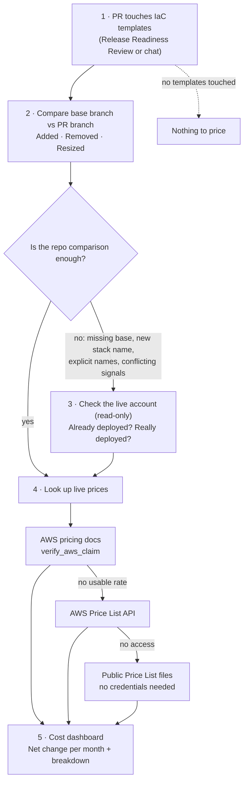

# Estimate New Resource Costs

See what a pull request will do to your AWS bill before you merge it.

This skill for AWS DevOps Agent reads the infrastructure-as-code change in a pull request, finds the resources it adds, removes, or resizes, and shows how much more (or less) the account will cost per month. Prices are looked up live on every run. The skill contains no price list of its own, so it never guesses or uses an outdated rate.

## Non-production disclaimer

⚠️ This skill is sample code, not intended for production use without additional review and testing. Validate it in a non-production environment first.

## Why use it

A Release Readiness Review tells you whether a change is safe to deploy. It doesn't tell you that the same PR adds a Multi-AZ database, a NAT gateway, and doubles a worker fleet, for a few hundred dollars a month before a single request is served. This skill puts that number in the review, next to the risk findings, so the reviewer can ask "is this spend expected?" before approving.

## What it does

1. **Picks up the change.** It runs automatically in every Release Readiness Review that touches CloudFormation, SAM, CDK-synthesized, or Terraform templates. You can also ask for it in chat. If the PR touches no templates, it says there is nothing to price.
2. **Compares the PR with the repo.** It compares the template on the base branch with the template on the PR branch and sorts every resource:
   - **Added:** the cost goes up.
   - **Removed:** the cost goes down.
   - **Resized** (instance type, storage, Multi-AZ, node count, desired capacity…): the cost changes by the difference.
   - **Unchanged for cost** (tags, policies, descriptions): counted, not priced.
3. **Checks the live account, only if the repo comparison isn't enough.** For a normal PR, the comparison in step 2 is the answer and this step is reported as "not needed". It runs, read-only, when:
   - the base version of the template can't be fetched;
   - the template is new, renamed or moved, and the repo names the stack it deploys to;
   - an added resource has an explicit name (`RoleName`, `BucketName`, …) that may already be taken;
   - the template or PR text describes changes to resources the base branch doesn't have;
   - or you ask for it.

   When it runs, an "added" resource that already exists isn't counted as new cost, and a "removed" resource that was never deployed isn't counted as a saving. It matches resources through the deployed CloudFormation stack, or by exact name. A similar-looking name such as `MyRole-a1b2c3` never counts as a match for `MyRole`.
4. **Looks up live prices,** trying three official AWS sources in order:
   1. Public AWS pricing documentation, through `verify_aws_claim`.
   2. The AWS Price List API.
   3. The public AWS Price List files, which need no AWS credentials.

   For each resource it picks the standard on-demand price (not reservation, Extended Support, or free-tier rows), converts units correctly, and multiplies by the size and count declared in the template.
5. **Shows a cost dashboard:** the net monthly change at the top, then tables for added, removed, and resized resources, what the account check changed, and where every price came from. Charges that depend on usage (requests, data transfer, GB processed) are listed without a dollar figure.

## How it works



## What you get

Every run uses the same layout, so reviews are easy to compare:

| Section | What it shows |
|---|---|
| 📊 Summary | Net monthly change, totals for added / removed / resized, the Region, and the price sources used |
| ➕ Added · ➖ Removed · 🔁 Resized | One row per price line: sizing, quantity, rate, monthly amount |
| 🔎 Topology adjustments | Whether the account check was needed, and if it ran, which resources it moved in or out of the total |
| 🧾 Pricing trace | For every rate: the filters sent, rate, unit, and monthly amount |
| 📈 Usage-dependent | Charges with no fixed monthly figure, and what drives them |
| ❔ Not determinable | Anything that couldn't be priced, with the exact reason |
| ⚠️ Caveats | List-price and baseline assumptions for this run |

If pricing can't be reached at all, a banner at the top quotes the exact error from each source and says what to fix. The resource tables are still filled in.

### Example

Abridged output for a PR that adds a database and a NAT gateway, removes a Redis cache, and doubles a worker fleet. The rates are real eu-west-1 on-demand prices from the AWS Price List file published 2026-10-15. Prices change over time.

```markdown
## 💰 IaC cost impact · acme/payments-infra · PR #14

### 📊 Summary
| Metric | Value |
|---|---|
| **Net monthly change** | **≈ +$258.43 / month** |
| Repo-based net (first check) | +$258.43 |
| Topology adjustment (second check) | $0.00 · not needed |
| ➕ Added | 4 resources · +$458.41 |
| ➖ Removed | 1 resource · −$334.34 |
| 🔁 Resized | 1 resource · +$134.36 |
| Pricing Region | eu-west-1 · from the deploy workflow |
| Baseline | `main` · topology check: not needed |
| Price source | AWS pricing docs: 0 lines · Price List API: 0 lines · offer files: 8 lines |

### ➕ Added resources
| # | Logical ID | Type | Sizing | Qty | Rate | Monthly |
|---|---|---|---|---:|---|---:|
| A1 | LedgerDb · instance | AWS::RDS::DBInstance | db.r6g.large · PostgreSQL · Multi-AZ | 1 | $0.504 / Hrs | +$367.92 |
| A1b | LedgerDb · storage | AWS::RDS::DBInstance | 200 GB gp3 · Multi-AZ | 1 | $0.254 / GB-Mo | +$50.80 |
| A2 | ReconcilerNatGateway · hours | AWS::EC2::NatGateway | 1 AZ | 1 | $0.048 / Hrs | +$35.04 |
| A3 | ReconcilerNatEip | AWS::EC2::EIP | public IPv4 | 1 | $0.005 / Hrs | +$3.65 |
| A4 | LedgerKey | AWS::KMS::Key | customer managed key | 1 | $1.00 / Keys | +$1.00 |
| | **Total added** | | | | | **+$458.41** |

### ➖ Removed resources
| # | Logical ID | Type | Sizing | Qty | Rate | Monthly |
|---|---|---|---|---:|---|---:|
| R1 | SessionCache | AWS::ElastiCache::ReplicationGroup | cache.r6g.large · Redis | 2 | $0.229 / Hrs | −$334.34 |
| | **Total removed** | | | | | **−$334.34** |

### 🔁 Resized resources
| # | Logical ID | Change (before → after) | Before | After | Delta |
|---|---|---|---:|---:|---:|
| Z1 | WorkerAsg · instances | DesiredCapacity 2 → 4 · m6g.large Linux | $125.56 | $251.12 | +$125.56 |
| Z1b | WorkerAsg · EBS | 50 GB gp3 per instance · 2 → 4 | $8.80 | $17.60 | +$8.80 |
| | **Total resized** | | | | **+$134.36** |

### 🔎 Topology adjustments (second check)
_Topology check not needed: the base and PR versions of the template were both available, and no added resource declares an explicit name. Net change equals the repo-based net._

### 📈 Usage-dependent (not in total)
| Logical ID | Billed on |
|---|---|
| ReconcilerNatGateway | GB of data processed |
| LedgerKey | API requests |
```

The real output also includes the full pricing trace, with the source and filters for each rate, the not-determinable table, and the caveats. Some columns are trimmed here to keep the example short.

## Prerequisites

- **AWS DevOps Agent** with an Agent Space.
- **Release Readiness Review** enabled on the repository, for the automatic path.
- **A repository integration** (GitHub or GitLab), so the skill can read a PR's diff and files. No CI/CD pipeline is needed.
- **At least one pricing source.** The skill tries them in order and uses the first that works:

  | Source | What it needs |
  |---|---|
  | AWS pricing docs | The `verify_aws_claim` tool available to the agent |
  | AWS Price List API | An AWS tool in the agent with the permissions below |
  | Public Price List files | Outbound HTTPS to `pricing.us-east-1.amazonaws.com` (no credentials) |

  IAM policy for the Price List API, added to the role the Agent Space assumes:

  ```json
  {
    "Version": "2012-10-17",
    "Statement": [
      {
        "Sid": "ResolveLivePricing",
        "Effect": "Allow",
        "Action": [
          "pricing:GetProducts",
          "pricing:GetAttributeValues",
          "pricing:DescribeServices"
        ],
        "Resource": "*"
      }
    ]
  }
  ```

  Price List data is public and free to query. The API is called in `us-east-1`, with `eu-central-1` and `ap-south-1` as fallbacks, whatever Region your resources run in. If your AWS tool is restricted to certain Regions, allow one of these.

- **Optional, for the account check** (used only when the repo comparison isn't enough): read-only access to CloudFormation (`DescribeStacks`, `ListStacks`, `DescribeStackResources`) and to describe/get calls on the resource types in your templates. The default read-only managed policy covers this. Without it, the skill still produces the repo-based estimate and says the account check was skipped.

The skill performs no write actions. It never creates stacks, change sets, or any other resource.

## Getting prices in Release Readiness Reviews (recommended)

A Release Readiness Review runs in phases, and they don't all have the same tools. The analysis phase, which writes the report, usually can't fetch prices. [Verification testing](https://docs.aws.amazon.com/devopsagent/latest/userguide/release-management-release-readiness-code-review.html) has a shell and can reach `*.amazonaws.com`, which includes the public Price List files, and its findings are added to the final report. Without guidance, the tester doesn't always price the change, and the cost dashboard then shows the ⛔ banner.

To make pricing part of every review, add this to the `AGENTS.md` at the root of each repository that holds infrastructure code. AWS DevOps Agent reads `AGENTS.md` to tune how verification testing runs.

```markdown
## Verification testing: IaC cost estimate

When a change touches CloudFormation, SAM, CDK-synthesized or Terraform files, always add a test named
"IaC cost estimate" to the test plan and run it:

1. Follow the estimate-new-resource-costs skill, Steps 1–5: compare the base and PR versions of each
   template, then collect sizing, quantity and Region.
2. Fetch on-demand rates from the public AWS Price List files with an HTTP GET (no credentials needed):
   https://pricing.us-east-1.amazonaws.com/offers/v1.0/aws/<ServiceCode>/current/<region-code>/index.csv
   Stream the file line by line and keep only rows where TermType is OnDemand.
3. Report one line per priced item as the test result: logical ID, sizing, quantity, SKU, rate, unit,
   monthly amount, plus the net monthly change. List usage-based charges without a figure.

Use read-only calls only. Never deploy, create change sets, or call any AWS API that changes resources.
```

The analysis phase then reuses those recorded prices to build the dashboard in the final report.

## How to use it

**In a Release Readiness Review:** nothing to do. The cost section appears whenever the PR touches a template.

**In chat:** name the repository, the PR or branch, and ideally the Region:

- "What does PR #14 in acme/payments-infra add or remove, and how much more will it cost per month? It deploys to eu-west-1."
- "Compare `cloudformation/payments-ledger.yaml` on `feature/ledger-rds-nat` against `main` and estimate the monthly change."
- "This repo has no pipeline. Fetch PR #12 yourself and tell me the net monthly cost change."

## Uploading to AWS DevOps Agent

**Option A: GitHub integration.** Fork or copy this repository and import the skill through the Agent Space GitHub integration.

**Option B: Direct upload.** Zip the skill and upload it as a user-defined skill in the Agent Space console. Run from inside the skill folder, so that `SKILL.md` sits at the root of the zip:


## Skill contents

```
estimate-new-resource-costs/
├── SKILL.md                      # Workflow checklist, both checks, the pricing core, a dashboard skeleton, caveats
├── references/
│   └── pricing-sources.md        # Full procedure for each pricing source (read in Step 5)
├── assets/
│   └── output-template.md        # Full dashboard template and formatting rules (read in Step 7)
└── README.md                     # This file
```

`SKILL.md` deliberately keeps the full Price List API procedure and a dashboard skeleton inline, even though `references/` and `assets/` also exist. In a Release Readiness Review several agents read the skill, and they don't always open extra files. Keeping the API procedure in `SKILL.md` is what lets any agent that loads the skill price the change; in testing, versions that moved it out stopped pricing. This is a known trade-off against the Agent Skills best-practice check for reference material in the body (BP-03), and it is intentional.
